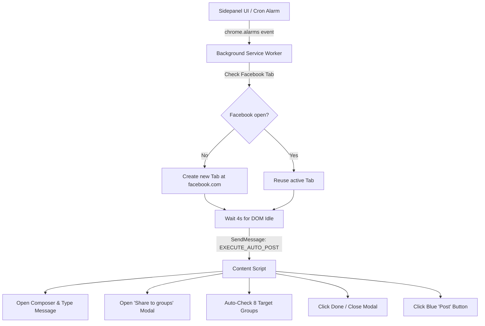

# Project Handover Guide: Devmanus Facebook AI Extension

> **Purpose**: This document provides everything needed to understand, configure, run, and extend this project. Hand this file over to anyone assisting with development, testing, or deployment.

---

## 1. Executive Summary

**Devmanus** is an autonomous Chrome Manifest V3 extension with a React sidepanel and a local Node.js/Express backend that automates promotional Facebook post scheduling and distribution.

### Core Capabilities:
1. **1-Click / Scheduled Facebook Posting**: Automatically opens Facebook, focuses the "What's on your mind" composer, fills the promotional copy, and posts it.
2. **Auto-Select 8 Target Groups**: Opens Facebook's "Share to groups" selector and clicks up to Facebook's 9-group limit for target DevOps, SRE, and Proxy Job Support groups.
3. **Flexible Cron Scheduling**: Background scheduling engine (`chrome.alarms`) that runs every `1 Min`, `5 Min`, `1 Hr`, `2 Hrs`, `3 Hrs`, `4 Hrs`, `5 Hrs`, or any custom minute interval — even when the sidepanel is closed.
4. **100% Free, Local Open-Source AI**: Powered by local Ollama (`llama3.2:1b` / `llama3.2:3b`), with zero OpenAI API keys, zero cloud subscriptions, and complete data privacy.

---

## 2. Quick Start for Collaborators (2-Minute Setup)

### System Requirements
- **OS**: macOS (Apple Silicon M1/M2/M3/M4 or Intel), Linux, or Windows.
- **Node.js**: v20.0.0 or higher (`node -v`).
- **Ollama**: Free local model runner from [https://ollama.com](https://ollama.com).
- **Google Chrome**.

### Setup Commands

#### On macOS / Linux:
```bash
# 1. Run automated setup (installs npm dependencies, pulls AI model, builds dist/)
chmod +x setup-mac.sh
./setup-mac.sh

# 2. Start the local backend and extension builder
npm run dev:all
# Or use the single-click starter:
./start.sh
```

#### On Windows (Command Prompt or PowerShell):
```cmd
REM 1. Run automated Windows setup (or double-click setup-windows.bat)
setup-windows.bat

REM 2. Start backend & frontend watcher
start-windows.bat
REM Or via npm:
npm run dev:all
```
*(PowerShell users can also run: `.\setup-windows.ps1`)*

#### Or Via Docker (macOS, Windows, or Linux):
```bash
# 1-Click Docker start (Builds backend, starts Ollama, auto-pulls llama3.2:1b)
./docker-start.sh       # On macOS / Linux
docker-start.bat        # On Windows
# Or simply:
docker compose up -d
```

### Loading Extension in Google Chrome
1. In Chrome, open `chrome://extensions`.
2. Toggle on **Developer mode** in the top-right corner.
3. Click the **Load unpacked** button.
4. Select the `dist/` directory inside this repository.
5. Click the puzzle icon in Chrome's toolbar, locate **Devmanus fb extension**, and pin it.
6. Click the extension icon to reveal the side panel.

---

## 3. Open-Source AI Model Architecture & Tuning

### Why `llama3.2:1b` is the Default
- **RAM Footprint**: ~1.3 GB (zero memory pressure on 8GB unified memory Macs).
- **Inference Latency**: **1.2s – 2.0s** per plan generation.
- **Tuning**: Configured with `num_ctx: 2048`, `keep_alive: "60m"`, and `temperature: 0.1` in `server/src/index.ts`.

### How to Switch Models
Open [`server/.env`](file:///Users/anshyadav/Downloads/devmanus-fb-extension/server/.env):
```env
LLM_PROVIDER=ollama
OLLAMA_BASE_URL=http://127.0.0.1:11434

# Change this value to any model you pull:
OLLAMA_MODEL=llama3.2:1b
```

| Model | Memory | Speed (M-series Mac) | Best For |
|---|---|---|---|
| `llama3.2:1b` *(Default)* | 1.3 GB | ~1.5 sec | Ultra-fast daily automation on 8GB RAM |
| `llama3.2:3b` | 2.0 GB | ~3.5 sec | Complex DOM reasoning on 16GB+ RAM |
| `devmanus-agent` | 1.3 GB | ~1.5 sec | Custom Modelfile with embedded system prompt |
| `qwen2.5:3b` | 1.9 GB | ~3.8 sec | Strict JSON schema generation |

To compile the custom `devmanus-agent` model:
```bash
./ollama/setup-models.sh
```

---

## 4. Automation & Cron Engine Architecture

### The Automation Flow


### Pre-Configured Target Groups
The content script (`src/content/content-script.ts`) automatically matches and clicks these 8 groups:
1. `DevOps, SRE, and Platform Engineering Jobs`
2. `Job support , proxy interviews and trainings for US candidate s`
3. `Data Engineer proxy support`
4. `Data Engineer & Devops Job Support`
5. `DevOps(Docker + Kubernetes) Group`
6. `IT Job Support & Interview Proxy`
7. `SAP projects , training, proxy, job support.`
8. `Interview Proxy & Support | Data Engineer | Data Analyst | Java Full Stack`

To add or modify target groups, edit `DEFAULT_TARGET_GROUPS` in [`src/content/content-script.ts`](file:///Users/anshyadav/Downloads/devmanus-fb-extension/src/content/content-script.ts) and [`src/sidepanel/App.tsx`](file:///Users/anshyadav/Downloads/devmanus-fb-extension/src/sidepanel/App.tsx).

---

## 5. Codebase Directory Map

```text
devmanus-fb-extension/
├── dist/                          # Compiled extension bundle loaded into Chrome
├── config/
│   └── ai-models.json             # AI model specification & hardware profiles
├── ollama/
│   ├── Modelfile                  # 1B parameter agent definition with embedded prompt
│   ├── Modelfile.3b               # 3B parameter agent definition
│   └── setup-models.sh            # Automated model pulling & test script
├── server/
│   ├── src/
│   │   └── index.ts               # Express server, Ollama API connector & JSON sanitizer
│   ├── .env                       # Local server environment configuration
│   ├── .env.example               # Example template for .env
│   └── package.json               # Backend dependencies (Express, CORS, Zod)
├── src/
│   ├── background/
│   │   └── service-worker.ts      # MV3 Service worker, chrome.alarms cron scheduler
│   ├── content/
│   │   └── content-script.ts      # DOM automation, group selector & Facebook composer
│   ├── security/
│   │   └── action-validator.ts    # Action validation allowlist & 5000-char safety gate
│   ├── sidepanel/
│   │   ├── App.tsx                # Sidepanel UI: cron presets, group toggles, manual run
│   │   ├── index.html             # Sidepanel HTML entry point
│   │   └── styles.css             # Dark/modern sidepanel styling & animations
├── manifest.json                  # Chrome Manifest V3 configuration
├── vite.config.ts                 # CRXJS Vite bundler config
├── setup-mac.sh                   # 1-Click setup installer
├── start.sh                       # 1-Click startup script
└── README.md                      # GitHub documentation
```

---

## 6. Troubleshooting & Common Questions

### Q1: The backend says "Could not reach Ollama at http://127.0.0.1:11434"
- **Fix**: Launch Ollama by opening the Ollama application or running `ollama serve` in a terminal.
- Test with: `curl http://127.0.0.1:11434/api/tags`

### Q2: Chrome displays "Could not connect to local backend at http://127.0.0.1:3000"
- **Fix**: Make sure the backend server is running via `npm run dev:all` or `cd server && npm run dev`.
- Test with: `curl http://127.0.0.1:3000/health`

### Q3: How do I test the cron job immediately without waiting 3 hours?
- In the sidepanel under **Schedule Interval**, click the **1 Min** or **5 Min** pill button, or click **"Post Now"** for an immediate test.

### Q4: I edited code, but Chrome isn't showing the changes.
- In `chrome://extensions`, locate **Devmanus fb extension** and click the circular **Reload** icon on its card. Then reopen the sidepanel.
