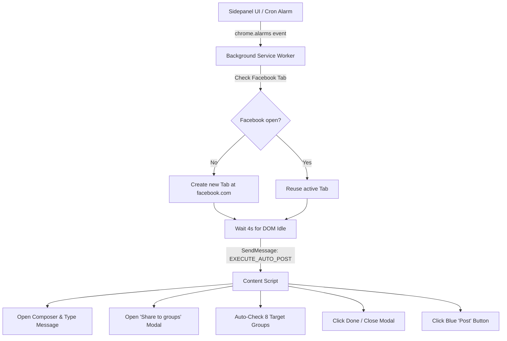

# Project Handover Guide: Devmanus Facebook Extension

> **Purpose**: This document provides everything needed to understand, configure, run, and extend this project. Hand this file over to anyone assisting with development, testing, or deployment.

---

## 1. Executive Summary

**Devmanus** is an autonomous Chrome Manifest V3 extension with a React sidepanel and background cron scheduler that automates promotional Facebook post scheduling and distribution.

### Core Capabilities:
1. **1-Click / Scheduled Facebook Posting**: Automatically opens Facebook, focuses the "What's on your mind" composer, fills the promotional copy, and posts it.
2. **Auto-Select 8 Target Groups**: Opens Facebook's "Share to groups" selector and clicks up to Facebook's 9-group limit for target DevOps, SRE, and Proxy Job Support groups.
3. **Flexible Cron Scheduling**: Background scheduling engine (`chrome.alarms`) that runs every `1 Min`, `5 Min`, `1 Hr`, `2 Hrs`, `3 Hrs`, `4 Hrs`, `5 Hrs`, or any custom minute interval — even when the sidepanel is closed.
4. **Zero AI Dependencies & Zero API Keys**: 100% deterministic, high-speed DOM automation with zero external model overhead and zero subscriptions.

---

## 2. Quick Start for Collaborators (2-Minute Setup)

### System Requirements
- **OS**: macOS (Apple Silicon M1/M2/M3/M4 or Intel), Linux, or Windows.
- **Node.js**: v20.0.0 or higher (`node -v`).
- **Google Chrome**.

### Setup Commands

#### Standard Setup (macOS, Windows, or Linux):
```bash
# 1. Install dependencies
npm install

# 2. Build the extension bundle (creates dist/)
npm run build

# 3. Start local development watcher
npm run dev
```

#### Or Via Docker (macOS, Windows, or Linux):
```bash
# 1-Click Docker start (Builds backend and Chrome extension bundle)
./docker-start.sh       # On macOS / Linux
docker-start.bat        # On Windows
# Or simply:
docker compose up -d
```

### Loading Extension in Google Chrome
1. In Chrome, open `chrome://extensions`.
2. Toggle on **Developer mode** in the top-right corner.
3. Click the **Load unpacked** button.
4. Select the `dist/` directory inside this repository.
5. Click the puzzle icon in Chrome's toolbar, locate **Devmanus fb extension**, and pin it.
6. Click the extension icon to reveal the side panel.

---

## 3. Automation & Cron Engine Architecture

### The Automation Flow


### Pre-Configured Target Groups
The content script (`src/content/content-script.ts`) automatically matches and clicks these 8 groups:
1. `DevOps, SRE, and Platform Engineering Jobs`
2. `Job support , proxy interviews and trainings for US candidate s`
3. `Data Engineer proxy support`
4. `Data Engineer & Devops Job Support`
5. `DevOps(Docker + Kubernetes) Group`
6. `IT Job Support & Interview Proxy`
7. `SAP projects , training, proxy, job support.`
8. `Interview Proxy & Support | Data Engineer | Data Analyst | Java Full Stack`

To add or modify target groups, edit `DEFAULT_TARGET_GROUPS` in [`src/content/content-script.ts`](file:///Users/anshyadav/Downloads/devmanus-fb-extension/src/content/content-script.ts) and [`src/sidepanel/App.tsx`](file:///Users/anshyadav/Downloads/devmanus-fb-extension/src/sidepanel/App.tsx).

---

## 4. Codebase Directory Map

```text
devmanus-fb-extension/
├── dist/                          # Compiled extension bundle loaded into Chrome
├── server/
│   ├── src/
│   │   └── index.ts               # Express server and dist preview
│   ├── .env                       # Local server environment configuration
│   ├── .env.example               # Example template for .env
│   └── package.json               # Backend dependencies (Express, CORS)
├── src/
│   ├── background/
│   │   └── service-worker.ts      # MV3 Service worker, chrome.alarms cron scheduler
│   ├── content/
│   │   └── content-script.ts      # DOM automation, group selector & Facebook composer
│   ├── security/
│   │   ├── guard.ts               # Author integrity validation
│   │   ├── auth-config.json       # Master password hash
│   │   └── author-public.json     # Public verification key
│   ├── sidepanel/
│   │   ├── App.tsx                # Sidepanel UI: cron presets, group toggles, manual run
│   │   ├── index.html             # Sidepanel HTML entry point
│   │   └── styles.css             # Dark/modern sidepanel styling & animations
├── manifest.json                  # Chrome Manifest V3 configuration
├── vite.config.ts                 # CRXJS Vite bundler config
└── README.md                      # GitHub documentation
```

---

## 5. Troubleshooting & Common Questions

### Q1: How do I test the cron job immediately without waiting 3 hours?
- In the sidepanel under **Schedule Interval**, click the **1 Min** or **5 Min** pill button, or click **"Post Now"** for an immediate test.

### Q2: I edited code, but Chrome isn't showing the changes.
- In `chrome://extensions`, locate **Devmanus fb extension** and click the circular **Reload** icon on its card. Then reopen the sidepanel.
