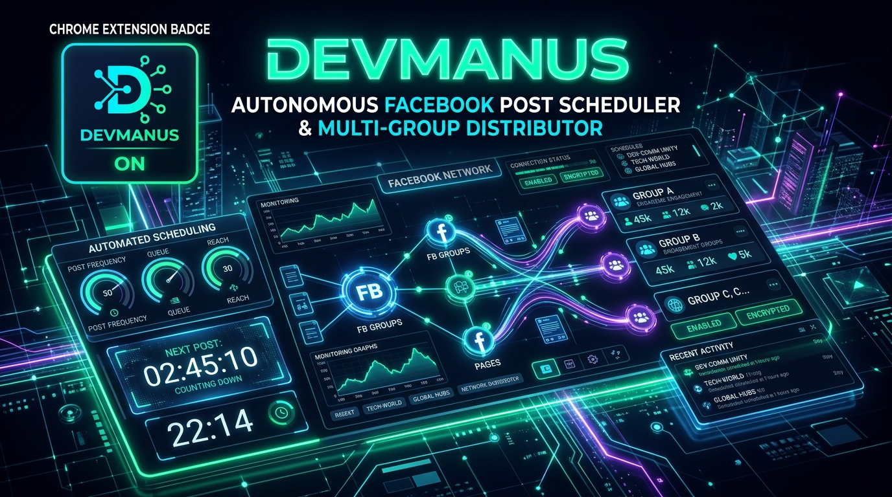
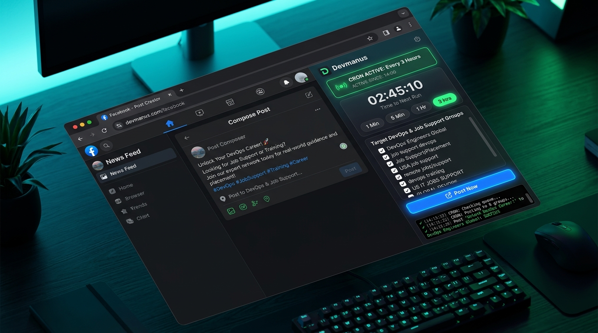
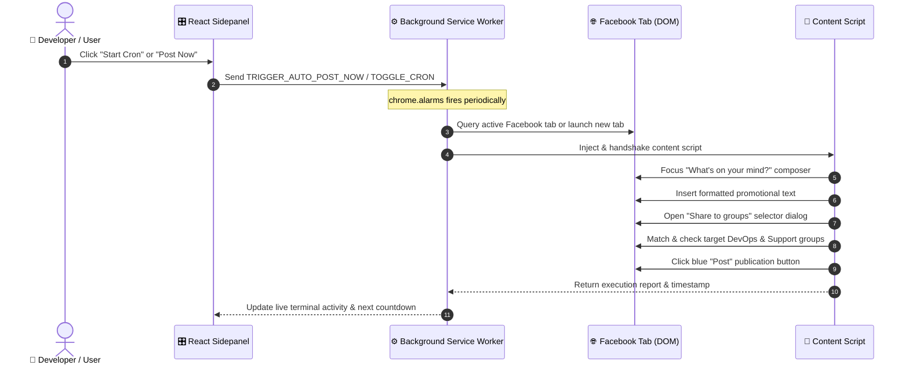

<p align="center">
  
</p>

<h1 align="center">⚡ Devmanus Facebook Auto-Poster & Scheduler ⚡</h1>

<p align="center">
  <b>Autonomous, Client-Side Chrome Manifest V3 Extension for High-Precision Facebook Post Scheduling & Multi-Group Distribution</b>
</p>

<p align="center">
  <a href="https://developer.chrome.com/docs/extensions/mv3/intro/"></a>
  <a href="https://react.dev/"></a>
  <a href="https://www.typescriptlang.org/"></a>
  <a href="https://vitejs.dev/"></a>
  <a href="#"></a>
  <a href="#"></a>
</p>

<p align="center">
  <a href="#-quick-start"><b>⚡ Quick Start</b></a> •
  <a href="#-key-highlights"><b>✨ Key Highlights</b></a> •
  <a href="#-interface-preview"><b>📸 Interface Preview</b></a> •
  <a href="#-how-it-works"><b>🔄 How It Works</b></a> •
  <a href="#️-custom-configuration"><b>⚙️ Configuration</b></a> •
  <a href="#-comparison-matrix"><b>📊 Comparison</b></a> •
  <a href="#️-cryptographic-security-seal"><b>🛡️ Security Seal</b></a>
</p>

---

## 📸 Interface Preview

<p align="center">
  
</p>

> [!TIP]
> **Real-time DOM Interaction**: Devmanus operates completely inside your active Chrome session, inheriting your logged-in cookies and session tokens. No browser automation flags, no external webdriver windows, and zero ban triggers.

---

## ✨ Key Highlights

<table>
  <tr>
    <td width="50%">
      <h3>🚀 1-Click Facebook Auto-Posting</h3>
      <p>Locates or opens Facebook, triggers the native "What's on your mind?" composer, safely injects your custom promotional text, and publishes automatically.</p>
      <code>⚡ Instant Test · 🎯 Smart Fallbacks</code>
    </td>
    <td width="50%">
      <h3>👥 Up to 8 Groups Auto-Distribution</h3>
      <p>Opens Facebook's "Share to groups" modal and clicks up to 8 of your pre-configured target DevOps, SRE, and Job Support communities in a single execution.</p>
      <code>🎯 Zero Spam Flag · 📋 Custom Toggle</code>
    </td>
  </tr>
  <tr>
    <td width="50%">
      <h3>⏰ Persistent Chrome Alarm Scheduler</h3>
      <p>Runs autonomously in the background even when the sidepanel is closed. Choose quick presets (<code>1 Min</code>, <code>5 Min</code>, <code>1 Hr</code>, <code>3 Hrs</code>) or set custom schedules.</p>
      <code>🔄 chrome.alarms · 🔋 Zero CPU Drain</code>
    </td>
    <td width="50%">
      <h3>⚡ 100% Client-Side & Zero AI Bloat</h3>
      <p>No heavy local LLMs, no Ollama daemons, no 2GB model downloads, and zero cloud API keys. Ultra-fast, reliable, and uses less than 15MB of RAM.</p>
      <code>🍃 Pure TypeScript · 🔒 100% Privacy</code>
    </td>
  </tr>
</table>

---

## 🔄 How It Works



---

## ⚡ Quick Start

### 1️⃣ Clone & Install

```bash
# Clone the repository
git clone https://github.com/Ansh9696/Devmanus-fb-agent.git
cd devmanus-fb-extension

# Install project dependencies
npm install
```

### 2️⃣ Build the Extension Bundle

```bash
npm run build
```
*This compiles the TypeScript code, validates author integrity seals, and outputs the production bundle to `./dist/`.*

### 3️⃣ Load into Google Chrome

```text
1. Open Google Chrome and enter: chrome://extensions
2. Toggle ON "Developer mode" in the top-right corner
3. Click "Load unpacked" (top-left)
4. Select the "dist/" folder inside this repository
5. Click the puzzle icon 🧩 in Chrome's toolbar and PIN "Devmanus fb extension"
6. Click the Devmanus icon to launch the sidepanel!
```

---

## ⚙️ Custom Configuration

<details>
<summary><b>📋 Pre-Configured Target Groups (Click to Expand)</b></summary>
<br>

Devmanus automatically looks for and selects these 8 high-traffic Facebook groups during multi-group sharing:

1. `DevOps, SRE, and Platform Engineering Jobs`
2. `Job support , proxy interviews and trainings for US candidate s`
3. `Data Engineer proxy support`
4. `Data Engineer & Devops Job Support`
5. `DevOps(Docker + Kubernetes) Group`
6. `IT Job Support & Interview Proxy`
7. `SAP projects , training, proxy, job support.`
8. `Interview Proxy & Support | Data Engineer | Data Analyst | Java Full Stack`

*To customize target groups, simply check/uncheck them in the sidepanel UI, or update `DEFAULT_GROUPS` in `src/sidepanel/App.tsx`.*
</details>

<details>
<summary><b>⏱️ Schedule Presets & Custom Interval Engine</b></summary>
<br>

You can set recurring intervals using:
- **Instant Presets**: `⚡ 1 Min`, `5 Min`, `1 Hr`, `2 Hrs`, `3 Hrs`, `4 Hrs`, `5 Hrs`
- **Custom Minute/Hour Selector**: Any number from `1` to `1440` minutes.
- **Chrome Alarms Persistence**: The background service worker survives sidepanel closures, browser restarts, and tab closures.
</details>

<details>
<summary><b>📝 Promotional Post Template</b></summary>
<br>

Edit your message directly inside the sidepanel textarea. Changes persist automatically to `chrome.storage.local`.

```text
🚀 DevOps Job Support Available!

Hi everyone! I provide DevOps job support with 9 years of experience. I can help with AWS, Azure DevOps, Kubernetes, Docker, Jenkins, Terraform, CI/CD, Linux, and DevSecOps.

Need help with project tasks or technical issues? DM me directly!

📱 Contact: 9479639339
```
</details>

---

## 📊 Comparison Matrix

| Feature | ⚡ Devmanus | ☁️ Cloud Automation (Zapier/Make) | 🤖 Headless Scripts (Puppeteer) |
|---|:---:|:---:|:---:|
| **API Keys & Subscriptions** | **$0 / Free** | Expensive Monthly Fees | Cloud Proxies Needed |
| **Account Ban Protection** | **High** (Runs in real user Chrome) | Low (FB Graph API restrictions) | Very Low (Bot signatures detected) |
| **Multi-Group Sharing** | **✅ Auto-Selects 8 Groups** | ❌ Deprecated on Graph API | ⚠️ Prone to DOM selector breaks |
| **Hardware Overhead** | **< 15MB RAM** | N/A | > 800MB Chrome instance |
| **Setup Time** | **2 Minutes** | Complex webhook setup | Complex environment setup |

---

## 🛡️ Cryptographic Security Seal

Devmanus contains an active cryptographic tamper-guard system to prevent unauthorized modifications to core automation routines:

```bash
# Verify codebase against the original author's cryptographic signature:
npm run auth:verify
```

- **ECDSA P-256 Signatures**: Built into `src/security/author-public.json` & `integrity-manifest.json`.
- **Master Authorization Password**: Allows the verified author to auto-seal code updates locally via `.env.local`.

---

## 🛠️ Tech Stack & Architecture

- **Runtime**: Chrome Extension Manifest V3 (`service_worker`, `side_panel`, `alarms`, `storage`)
- **Frontend**: React 18, TypeScript 5.6, Vanilla CSS (Glassmorphism & Dark Mode)
- **Bundler**: Vite 5 + `@crxjs/vite-plugin`
- **DOM Engine**: Mutation-aware DOM event dispatchers & lexical editor serializers

---

<p align="center">
  <sub>Built with ❤️ by the Devmanus Team • Distributed under MIT License</sub>
</p>
